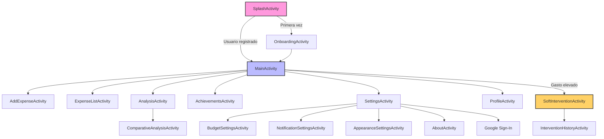
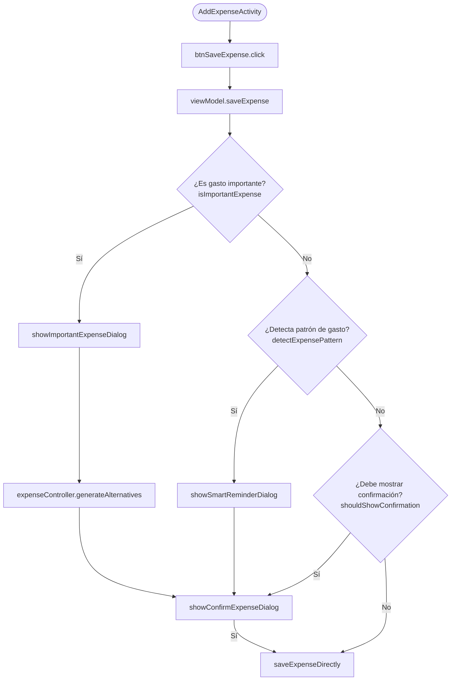

# Proyecto Equilibra

## Estado actual del proyecto

Este documento refleja el estado observado del proyecto a fecha de 2026-10-18.
La aplicación es un proyecto Android nativo en Java con Gradle Kotlin DSL y utiliza una arquitectura basada en actividades, view models, repositorios y Room para el almacenamiento local.

Además, el proyecto ya incluye integración con Firebase para autenticación y sincronización de datos, así como un flujo de sincronización en segundo plano mediante WorkManager.

---

## Objetivo de la app

Equilibra es una app para el seguimiento financiero personal y el bienestar económico. Permite:

- registrar ingresos y gastos;
- analizar el comportamiento mensual;
- visualizar metas de ahorro;
- gestionar perfil y configuración;
- mostrar intervenciones suaves cuando el gasto o el patrón de consumo lo requiere;
- sincronizar datos locales con Firebase.

---

## Arquitectura actual

### Capas principales

- **Activities / UI**: pantallas principales y configuración.
- **ViewModels**: preparación de datos para la interfaz.
- **Controllers**: lógica de negocio específica.
- **Repositories**: acceso a datos locales y sincronización remota.
- **Database / Room**: persistencia local mediante `AppDatabase` y DAOs.
- **Workers**: operaciones en segundo plano para sincronización con la nube.

### Tecnologías principales

- Android SDK / Jetpack
- Java 21
- Room 2.6.1
- ViewModel + LiveData
- WorkManager
- Firebase Auth
- Firebase Firestore
- Google Services plugin

---

## Persistencia local

El proyecto usa Room para la capa local. El componente principal es:

- `AppDatabase`: base de datos principal.
- `ExpenseDao`: acceso a gastos.
- Otros DAOs y repositorios gestionan perfil, metas, presupuestos, logros y otras entidades.

La capa de repositorios centraliza el acceso a datos y, en el caso de los gastos, también dispara la sincronización con la nube tras cambios.

---

## Sincronización con Firebase

La sincronización con Firebase ya está integrada en el proyecto.

### Piezas relevantes

- `CloudSyncRepository`
  - gestiona la autenticación;
  - usa inicio de sesión anónimo si no hay usuario activo;
  - sube datos locales a Firestore.

- `CloudSyncWorker`
  - ejecuta la sincronización en segundo plano con WorkManager;
  - reintenta la tarea cuando la red no está disponible.

- `ExpenseRepository`
  - tras insertar, actualizar o eliminar un gasto, programa una sincronización inmediata.

### Flujo esperado

1. El usuario crea, modifica o elimina un gasto.
2. El repositorio local actualiza la base de datos.
3. Se programa una sincronización con `CloudSyncRepository`.
4. WorkManager ejecuta la tarea cuando hay red disponible.
5. Firebase Auth / Firestore reciben los datos sincronizados.

---

## Estructura general del proyecto

```text
app/
├── src/main/
│   ├── java/asunfdiez/com/equilibra/
│   │   ├── activities/
│   │   ├── adapters/
│   │   ├── controllers/
│   │   ├── database/
│   │   ├── models/
│   │   ├── repositories/
│   │   ├── utils/
│   │   ├── viewmodels/
│   │   ├── views/
│   │   └── workers/
│   ├── res/
│   │   ├── layout/
│   │   ├── drawable/
│   │   ├── values/
│   │   └── xml/
│   └── AndroidManifest.xml
├── build.gradle.kts
└── google-services.json
```

---


## Pantallas principales

La app incluye pantallas para:

- splash / inicio;
- onboarding;
- dashboard principal;
- añadir y listar gastos;
- análisis financiero;
- logros;
- perfil y configuración;
- ajustes de presupuesto, apariencia y notificaciones;
- lista de intervenciones.

---

## Configuración de Firebase

La configuración actual del proyecto incluye:

- `google-services.json` en la carpeta `app/`;
- plugin `com.google.gms.google-services` en Gradle;
- dependencias de Firebase Auth, Firestore y Analytics;
- uso de Firebase para la sincronización remota.

---

## Cómo trabajar con el proyecto

### Requisitos

- Android Studio con soporte para Java 21 y Android Gradle Plugin.
- SDK Android suficiente para la configuración del proyecto.
- Acceso a la configuración de Firebase correspondiente.


---

## Resumen rápido

- La app es una aplicación Android Java con persistencia local Room.
- Existe una capa de sincronización con Firebase.
- `CloudSyncRepository` y `CloudSyncWorker` forman la base del sistema de nube.
- `ExpenseRepository` dispara la sincronización con la nube al editar gastos.

---

## 📂 Esquema Clases Java

```text
app/
├── src/
│   ├── main/
│   │   ├── java/
│   │   │   └── asunfdiez/com/equilibra/
│   │   │       ├── activities/
│   │   │       │   ├── SplashActivity.java
│   │   │       │   ├── OnboardingActivity.java
│   │   │       │   ├── MainActivity.java
│   │   │       │   ├── AddExpenseActivity.java
│   │   │       │   ├── ExpenseListActivity.java
│   │   │       │   ├── AnalysisActivity.java
│   │   │       │   ├── ComparativeAnalysisActivity.java
│   │   │       │   ├── AchievementsActivity.java
│   │   │       │   ├── SoftInterventionActivity.java
│   │   │       │   ├── InterventionHistoryActivity.java
│   │   │       │   ├── SettingsActivity.java
│   │   │       │   ├── ProfileActivity.java
│   │   │       │   ├── BudgetSettingsActivity.java
│   │   │       │   ├── AppearanceSettingsActivity.java
│   │   │       │   ├── NotificationSettingsActivity.java
│   │   │       │   ├── AboutActivity.java
│   │   │       │   └── ...
│   │   │       │
│   │   │       ├── viewmodels/
│   │   │       │   ├── SplashViewModel.java
│   │   │       │   ├── OnboardingViewModel.java
│   │   │       │   ├── MainViewModel.java
│   │   │       │   ├── AddExpenseViewModel.java
│   │   │       │   ├── ExpenseListViewModel.java
│   │   │       │   ├── AnalysisViewModel.java
│   │   │       │   ├── ComparativeAnalysisViewModel.java
│   │   │       │   ├── SettingsViewModel.java
│   │   │       │   ├── ProfileViewModel.java
│   │   │       │   ├── BudgetSettingsViewModel.java
│   │   │       │   ├── AppearanceSettingsViewModel.java
│   │   │       │   ├── NotificationSettingsViewModel.java
│   │   │       │   ├── AdviceViewModel.java
│   │   │       │   ├── GamificationViewModel.java
│   │   │       │   ├── AchievementsViewModel.java
│   │   │       │   ├── SoftInterventionViewModel.java
│   │   │       │   ├── InterventionHistoryViewModel.java
│   │   │       │   └── ...
│   │   │       │
│   │   │       ├── controllers/
│   │   │       │   ├── ExpenseController.java
│   │   │       │   ├── BudgetController.java
│   │   │       │   ├── AchievementController.java
│   │   │       │   ├── AnalyticsController.java
│   │   │       │   ├── UserProfileController.java
│   │   │       │   ├── CloudSyncController.java
│   │   │       │   ├── StreakController.java
│   │   │       │   ├── WellbeingController.java
│   │   │       │   ├── ExpenseViewHolder.java
│   │   │       │   ├── AchievementViewHolder.java
│   │   │       │   ├── InterventionLogViewHolder.java
│   │   │       │   └── ...
│   │   │       │
│   │   │       ├── repositories/
│   │   │       │   ├── ExpenseRepository.java
│   │   │       │   ├── BudgetRepository.java
│   │   │       │   ├── AchievementRepository.java
│   │   │       │   ├── UserProfileRepository.java
│   │   │       │   ├── ExpenseCategoryRepository.java
│   │   │       │   ├── AlternativeRepository.java
│   │   │       │   ├── SavingGoalRepository.java
│   │   │       │   ├── StreakRepository.java
│   │   │       │   ├── InterventionLogRepository.java
│   │   │       │   ├── CloudSyncRepository.java
│   │   │       │   └── ...
│   │   │       │
│   │   │       ├── models/
│   │   │       │   ├── Expense.java
│   │   │       │   ├── ExpenseCategory.java
│   │   │       │   ├── ExpenseWithCategory.java
│   │   │       │   ├── UserProfile.java
│   │   │       │   ├── Budget.java
│   │   │       │   ├── Achievement.java
│   │   │       │   ├── Streak.java
│   │   │       │   ├── SavingGoal.java
│   │   │       │   ├── InterventionLog.java
│   │   │       │   ├── InterventionMessage.java
│   │   │       │   ├── Alternative.java
│   │   │       │   ├── Advice.java
│   │   │       │   ├── SmartReminder.java
│   │   │       │   ├── CategoryAnalysis.java
│   │   │       │   ├── AnalysisState.java
│   │   │       │   ├── ComparativeAnalysisState.java
│   │   │       │   ├── FinancialData.java
│   │   │       │   ├── EmotionalState.java
│   │   │       │   ├── QuestionOption.java
│   │   │       │   ├── UserXP.java
│   │   │       │   └── ...
│   │   │       │
│   │   │       ├── adapters/
│   │   │       │   ├── ExpenseAdapter.java
│   │   │       │   ├── AchievementAdapter.java
│   │   │       │   ├── AchievementMiniAdapter.java
│   │   │       │   ├── CalendarAdapter.java
│   │   │       │   ├── CategoryAdapter.java
│   │   │       │   ├── CategoryLegendAdapter.java
│   │   │       │   ├── ComparativeAnalysisAdapter.java
│   │   │       │   ├── InterventionLogAdapter.java
│   │   │       │   ├── QuestionOptionAdapter.java
│   │   │       │   ├── ProfileBindingAdapter.java
│   │   │       │   ├── StreakBindingAdapter.java
│   │   │       │   ├── ChartBindingAdapter.java
│   │   │       │   ├── BindingAdapters.java
│   │   │       │   ├── GamificationBindingAdapters.java
│   │   │       │   └── ...
│   │   │       │
│   │   │       ├── database/
│   │   │       │   ├── AppDatabase.java
│   │   │       │   ├── UserProfileDao.java
│   │   │       │   ├── ExpenseDao.java
│   │   │       │   ├── ExpenseCategoryDao.java
│   │   │       │   ├── BudgetDao.java
│   │   │       │   ├── AchievementDao.java
│   │   │       │   ├── AlternativeDao.java
│   │   │       │   ├── SavingGoalDao.java
│   │   │       │   ├── StreakDao.java
│   │   │       │   ├── InterventionLogDao.java
│   │   │       │   ├── UserXPDao.java
│   │   │       │   ├── Converters.java
│   │   │       │   └── ...
│   │   │       │
│   │   │       ├── utils/
│   │   │       │   ├── Constants.java
│   │   │       │   ├── SharedPrefsManager.java
│   │   │       │   ├── DateUtils.java
│   │   │       │   ├── DatePickerHelper.java
│   │   │       │   ├── ValidationHelper.java
│   │   │       │   ├── InputValidator.java
│   │   │       │   ├── SavingGoalValidator.java
│   │   │       │   ├── AdviceManager.java
│   │   │       │   ├── NotificationManager.java
│   │   │       │   ├── AnimationHelper.java
│   │   │       │   ├── BottomNavigationHandler.java
│   │   │       │   ├── AchievementUnlockHelper.java
│   │   │       │   └── ...
│   │   │       │
│   │   │       ├── workers/
│   │   │       │   ├── CloudSyncWorker.java
│   │   │       │   ├── AutoIncomeWorker.java
│   │   │       │   ├── NotificationWorker.java
│   │   │       │   └── ...
│   │   │       │
│   │   │       ├── views/
│   │   │       │   ├── FeatureCard.java
│   │   │       │   ├── SelectorView.java
│   │   │       │   └── ...
│   │   │       │
│   │   │       └── ...
```

## 🎨 Estructura de Recursos

```text
res/
├── anim/                          # Animaciones XML
│   ├── fade_in.xml
│   ├── fade_out.xml
│   ├── slide_in_right.xml
│   ├── slide_in_left.xml
│   ├── slide_out_right.xml
│   ├── slide_out_left.xml
│   ├── scale_up.xml
│   └── bounce.xml
│
├── drawable/                      # Drawables y shapes
│   ├── bg_button_primary.xml
│   ├── bg_button_secondary.xml
│   ├── bg_card.xml
│   ├── bg_circular_progress.xml
│   └── ... (otros drawables)
│
├── layout/                        # Layouts XML
│   ├── activity_splash.xml
│   ├── activity_onboarding.xml
│   ├── activity_intermediate_user.xml
│   ├── activity_advanced_user.xml
│   ├── activity_main.xml
│   ├── activity_add_expense.xml
│   ├── activity_soft_intervention.xml
│   ├── activity_analysis.xml
│   ├── activity_achievements.xml
│   ├── item_expense.xml
│   ├── item_category.xml
│   ├── item_achievement.xml
│   └── component_*.xml (componentes reutilizables)
│
└── values/
    ├── colors.xml
    ├── strings.xml
    ├── dimens.xml
    ├── styles.xml
    └── themes.xml
```

## 🗺️ FLUJO DE NAVEGACIÓN




## ⚡ Flujo de Funcionamiento: Añadir Gasto

### El usuario ingresa el importe y la categoría, y presiona "Añadir Gasto"




## LISTADO DE ARCHIVOS

### **1. ACTIVITIES **

#### SplashActivity.java
- **Ubicación:** `/SplashActivity.java`
- **Propósito:** Pantalla de inicio con logo y animaciones
- **Características:**
  - Animaciones de entrada (fade in, scale up)
  - Navegación automática después de 2.5 segundos
  - Determina si mostrar Onboarding o MainActivity
  - Usa SharedPrefsManager para verificar estado

####  OnboardingActivity.java
- **Ubicación:** `/OnboardingActivity.java`
- **Propósito:** Cuestionario inicial de 6 pasos
- **Características:**
  - Flujo de 6 pantallas: Emocional, Validación, Preguntas (2), Meta de Ahorro, Resumen, Misión
  - Transiciones animadas entre pasos
  - Validación de campos
  - Selector de fecha
  - Guarda perfil de usuario en SharedPreferences

####  MainActivity.java
- **Ubicación:** `/MainActivity.java`
- **Propósito:** Dashboard principal de la app
- **Características:**
  - Resumen financiero (ingresos, gastos, balance)
  - Lista de gastos recientes (RecyclerView)
  - Progreso de meta de ahorro
  - Indicador de bienestar financiero
  - FAB para añadir gastos
  - Acceso a Análisis y Logros

####  AddExpenseActivity.java
- **Ubicación:** `/AddExpenseActivity.java`
- **Propósito:** Formulario para añadir gastos/ingresos
- **Características:**
  - RadioGroup para seleccionar tipo (gasto/ingreso)
  - Campos: importe, descripción, categoría, fecha
  - AutoCompleteTextView con categorías predefinidas
  - DatePicker para selección de fecha
  - Validación en tiempo real
  - Guarda en SQLite vía ExpenseController

####  SoftInterventionActivity.java
- **Ubicación:** `/SoftInterventionActivity.java`
- **Propósito:** Intervención suave cuando gastos son altos
- **Características:**
  - Diseño tipo diálogo
  - Mensaje personalizado según nivel de gastos
  - 3 tips de bienestar financiero
  - Animaciones de entrada escalonadas
  - Marca intervención como vista para no repetir

####  AnalysisActivity.java
- **Ubicación:** `/AnalysisActivity.java`
- **Propósito:** Análisis financiero con estadísticas
- **Características:**
  - Totales de ingresos, gastos y balance semanal/mensual
  - Gráficos de barras por categoría
  - 3 insights personalizados
  - Comparación con periodos anteriores
  - Promedio de gasto diario
  - Animaciones de barras y números

####  AchievementsActivity.java
- **Ubicación:** `/AchievementsActivity.java`
- **Propósito:** Sistema de logros gamificado
- **Características:**
  - Nivel actual del usuario (Principiante a Maestro)
  - Barra de progreso hacia siguiente nivel
  - Grid de logros (RecyclerView en modo Grid)
  - Logros bloqueados/desbloqueados con visual diferenciado
  - Total de puntos acumulados

#### SettingsActivity.java
- **Ubicación:** `/SettingsActivity.java`
- **Propósito:** Pantalla principal de configuración de la aplicación.
- **Características:**
  - Centro de ajustes con acceso a perfil, presupuesto, notificaciones, apariencia y “Acerca de”
  - Integración con Google Sign-In mediante Credential Manager
  - Gestión de limpieza y reinicio de datos
  - Navegación rápida desde la barra inferior
  - Animaciones de entrada en las tarjetas de configuración

#### ProfileActivity.java
- **Ubicación:** `/ProfileActivity.java`
- **Propósito:** Gestión del perfil del usuario.
- **Características:**
  - Visualización de datos personales del usuario
  - Edición del nombre y perfil
  - Sincronización con cuenta de Google
  - Posibilidad de cerrar sesión o eliminar cuenta
  - Observación del estado de autenticación y mensajes de éxito/error

#### ExpenseListActivity.java
- **Ubicación:** `/ExpenseListActivity.java`
- **Propósito:** Historial de gastos y movimientos del usuario.
- **Características:**
  - Lista detallada de gastos e ingresos
  - Filtro por fecha mediante calendario
  - Vista de importe total y agrupación mensual
  - Sincronización con la nube
  - Edición y eliminación de registros desde el detalle
  - Navegación con bottom navigation

#### ComparativeAnalysisActivity.java
- **Ubicación:** `/ComparativeAnalysisActivity.java`
- **Propósito:** Comparativa de datos financieros por periodo.
- **Características:**
  - Análisis comparativo por semanas o periodos seleccionados
  - Selector de periodo con spinner
  - RecyclerView para mostrar estados comparativos
  - Visualización de evolución financiera respecto a otros intervalos

#### BudgetSettingsActivity.java
- **Ubicación:** `/BudgetSettingsActivity.java`
- **Propósito:** Configuración del presupuesto mensual y seguimiento financiero.
- **Características:**
  - Edición de presupuesto mensual, semanal y diario
  - Activación/desactivación del presupuesto
  - Selector de moneda
  - Validación automática de cantidades
  - Persistencia del presupuesto en base de datos/local storage

#### AppearanceSettingsActivity.java
- **Ubicación:** `/AppearanceSettingsActivity.java`
- **Propósito:** Personalización visual de la experiencia de usuario.
- **Características:**
  - Selección del nivel de experiencia visual (principiante, intermedio, avanzado)
  - Cambio de tema
  - Cambio de idioma
  - Menús emergentes tipo selector con animaciones
  - Persistencia de preferencias del usuario

#### NotificationSettingsActivity.java
- **Ubicación:** `/NotificationSettingsActivity.java`
- **Propósito:** Configuración de alertas y recordatorios.
- **Características:**
  - Activación/desactivación de notificaciones generales
  - Notificaciones de presupuesto
  - Notificaciones de logros
  - Gestión de mensajes de estado mediante ViewModel

#### InterventionHistoryActivity.java
- **Ubicación:** `/InterventionHistoryActivity.java`
- **Propósito:** Historial de intervenciones suaves aplicadas al usuario.
- **Características:**
  - Listado de intervenciones registradas
  - Visualización de detalles asociados a cada gasto
  - Eliminación de registros de intervención
  - Navegación rápida desde la barra inferior

#### AboutActivity.java
- **Ubicación:** `/AboutActivity.java`
- **Propósito:** Información general y soporte de la aplicación.
- **Características:**
  - Muestra la versión actual de la app
  - Enlace a GitHub del proyecto
  - Contacto por correo de soporte
  - Licencias de librerías Open Source
  - Opción para compartir la app y valorarla en la tienda
  


### **2. CONTROLLERS **

#### ExpenseController.java
- **Ubicación:** `/ExpenseController.java`
- **Propósito:** Controlador de gastos e ingresos
- **Métodos principales:**
  - `addExpense()` - Añade gasto/ingreso
  - `getAllExpenses()` - Obtiene todos los gastos
  - `getRecentExpenses(limit)` - Gastos recientes limitados
  - `getExpensesThisMonth()` - Gastos del mes actual
  - `getTotalIncomeThisMonth()` - Total de ingresos
  - `getTotalExpensesThisMonth()` - Total de gastos
  - `getCategoryAnalysis()` - Análisis por categoría
  - `getAverageDailyExpense()` - Promedio diario
  - `deleteExpense(id)` - Elimina gasto

####  WellbeingController.java
- **Ubicación:** `/WellbeingController.java`
- **Propósito:** Controlador de bienestar financiero
- **Métodos principales:**
  - `shouldShowIntervention()` - Determina si mostrar intervención
  - `getInterventionMessage()` - Genera mensaje personalizado
  - `markInterventionAsSeen()` - Marca como vista
  - `getWellbeingScore()` - Calcula score 0-100
  - `areExpensesHigh()` - Verifica gastos altos
- **Lógica:**
  - Umbral de 80% ingresos vs gastos
  - Verifica gastos concentrados en 3 días
  - No muestra intervención más de 1 vez al día

#### AchievementController.java
- **Ubicación:** `/AchievementController.java`
- **Propósito:** Sistema de logros, progresión y gamificación del usuario.
- **Métodos principales:**
  - `getAllAchievements()` / `getAllAchievementsSync()` - Obtiene todos los logros
  - `getUnlockedAchievements()` - Logros desbloqueados
  - `getLockedAchievements()` - Logros pendientes
  - `getTotalPoints()` / `getTotalPointsSync()` - Puntos totales acumulados
  - `getUserLevel()` - Nivel actual del usuario
  - `getProgressToNextLevel()` - Progreso hacia el siguiente nivel
  - `checkAndUnlockAchievements()` - Verifica automáticamente qué logros se deben desbloquear
  - `unlockAchievement()` - Desbloquea un logro manualmente
  - `getRecentUnlocked()` - Recupera logros recientes
- **Lógica:**
  - Valida logros según número de gastos registrados
  - Comprueba rachas de uso diario y semanal
  - Revisa si el usuario cumple objetivos de presupuesto
  - Evalúa categorías utilizadas
  - Calcula ahorro acumulado para desbloquear logros de ahorro
  - Ejecuta la comprobación en segundo plano mediante un executor
  - Notifica con LiveData cuando un logro se desbloquea
- **Logros principales:**
  1. Primer gasto
  2. 10 gastos registrados
  3. 50 gastos registrados
  4. 100 gastos registrados
  5. 500 gastos registrados
  6. Racha semanal
  7. Racha mensual
  8. Racha de 100 días
  9. Crear presupuesto
  10. Mantenerse por debajo del presupuesto semanal
  11. Mantenerse por debajo del presupuesto mensual

#### UserProfileController.java
- **Ubicación:** `/UserProfileController.java`
- **Propósito:** Controlador principal del perfil del usuario.
- **Funcionalidad:**
  - Gestiona el usuario actual y sus datos de perfil
  - Actualiza la información del perfil y sincroniza cambios
  - Elimina el usuario y reinicia datos si es necesario
  - Evalúa el bienestar financiero del usuario
  - Genera consejos personalizados según el estado del perfil
  - Devuelve recomendaciones rápidas para completar perfil o presupuesto

#### BudgetController.java
- **Ubicación:** `/BudgetController.java`
- **Propósito:** Controlador de presupuesto y seguimiento financiero.
- **Métodos principales:**
  - `saveBudget()` - Guarda un presupuesto
  - `updateBudget()` - Actualiza el presupuesto existente
  - `getActiveBudget()` - Recupera el presupuesto activo
  - `updateCurrency()` - Cambia la moneda del presupuesto
  - `setBudgetEnabled()` - Activa o desactiva el presupuesto
  - `checkDailyBudgetStreak()` - Verifica si el usuario mantiene racha de presupuesto
  - `recordBudgetDay()` - Registra el cumplimiento del presupuesto diario

#### AnalyticsController.java
- **Ubicación:** `/AnalyticsController.java`
- **Propósito:** Controlador de análisis financiero y estadísticas.
- **Métodos principales:**
  - `getTotalExpensesInRange()` - Total de gastos en un rango
  - `getTotalIncomeInRange()` - Total de ingresos en un rango
  - `calculateSavings()` - Calcula ahorro neto
  - `calculateSavingsRate()` - Calcula porcentaje de ahorro
  - `getAverageExpense()` - Gasto medio
  - `getMaxExpense()` - Máximo gasto registrado
  - `getWeeklyExpenses()` - Gastos agrupados por días de la semana
  - `getMonthlyExpenses()` - Gastos agrupados por días del mes
  - `getTopCategoriesAnalysis()` - Análisis por categoría
  - `getGroupedCategoriesAnalysis()` - Análisis por categoría con agrupación de “Resto”
  - `calculateTrend()` - Calcula tendencia comparativa entre periodos

#### CloudSyncController.java
- **Ubicación:** `/CloudSyncController.java`
- **Propósito:** Controlador de sincronización con la nube y autenticación Firebase/Google.
- **Métodos principales:**
  - `login()` - Inicia sesión con Google en Firebase
  - `logout()` - Cierra sesión
  - `getFirebaseUserEmail()` - Obtiene el email del usuario autenticado
  - `isFirebaseAuthenticated()` - Comprueba si está autenticado
  - `syncNow()` - Ejecuta una sincronización inmediata

#### StreakController.java
- **Ubicación:** `/StreakController.java`
- **Propósito:** Controlador de rachas y seguimiento de hábitos.
- **Métodos principales:**
  - `getStreakByType()` - Obtiene la racha de un tipo concreto
  - `getStreakByTypeSync()` - Versión síncrona
  - `updateStreak()` - Actualiza una racha
  - `recordActivity()` - Registra actividad del usuario
  - `decrementActivity()` - Descuenta actividad si se elimina un gasto
  - `recordBudgetDay()` - Registra día cumplido de presupuesto
  - `resetWeeklyStreaks()` - Reinicia rachas semanales
  - `ensureStreaksExist()` - Verifica que existan rachas básicas
  - `initializeDefaultStreaks()` - Inicializa las rachas por defecto

### **3. MODELS (20 archivos)**

#### Expense.java
- **Ubicación:** `/Expense.java`
- **Propósito:** Representa una transacción financiera (gasto o ingreso).
- **Atributos principales:**
  - `id` (long)
  - `userId` (long)
  - `type` (String: "expense" o "income")
  - `amount` (double)
  - `category` (Long)
  - `description` (String)
  - `date` (String)
  - `time` (String)
  - `timestamp` (long)
  - `isRecurring` (boolean)
  - `patternCount` (int)
  - `notes` (String)
- **Métodos principales:** getters, setters, `isExpense()`, `getFormattedDateTime()`

#### UserProfile.java
- **Ubicación:** `/UserProfile.java`
- **Propósito:** Almacena el perfil del usuario y su configuración financiera.
- **Atributos principales:**
  - `id`
  - `name`
  - `email`
  - `photoUrl`
  - `phone`
  - `passwordHash`
  - `emotionalState`
  - `mainConcern`
  - `mainConcernId`
  - `timeAvailable`
  - `monthlyIncome`
  - `incomeDay`
  - `financialKnowledge`
  - `budgetExperience`
  - `savingsHabit`
  - `dayCount`
  - `weekProgress`
  - `weekGoal`
  - `weekCount`
  - `lastConnectionTimestamp`
  - `xp`
- **Propósito:** Controla el onboarding, datos del usuario y estado global de progreso

#### Budget.java
- **Ubicación:** `/Budget.java`
- **Propósito:** Define el presupuesto del usuario.
- **Atributos principales:**
  - `id`
  - `userId`
  - `monthlyBudget`
  - `weeklyBudget`
  - `dailyBudget`
  - `currency`
  - `enabled`
  - `createdAt`
  - `updatedAt`
- **Métodos principales:** `calculateWeeklyFromMonthly()`, `calculateDailyFromMonthly()`, `getCurrencySymbol()`

#### Achievement.java
- **Ubicación:** `/Achievement.java`
- **Propósito:** Representa un logro del sistema de gamificación.
- **Atributos principales:**
  - `id`
  - `userId`
  - `title`
  - `description`
  - `points`
  - `key`
  - `unlocked`
  - `unlockedAt`
  - `categoryColor`
  - `iconRes`
- **Propósito:** Permite registrar logros, XP y estado de desbloqueo

#### Streak.java
- **Ubicación:** `/Streak.java`
- **Propósito:** Controla rachas de uso o hábitos del usuario.
- **Atributos principales:**
  - `id`
  - `userId`
  - `type`
  - `consecutiveDays`
  - `startDate`
  - `lastActivityDate`
  - `maxStreakRecord`
  - `isActive`
- **Tipos principales:**
  - `TYPE_RECORDING`
  - `TYPE_BUDGET`
- **Métodos principales:** `recordActivity()`, `incrementCounter()`, `decrementCounter()`, `reset()`

#### SavingGoal.java
- **Ubicación:** `/SavingGoal.java`
- **Propósito:** Meta de ahorro del usuario.
- **Atributos principales:**
  - `id`
  - `userId`
  - `name`
  - `targetAmount`
  - `currentAmount`
  - `deadline`
  - `monthlySavingAmount`
  - `completed`
  - `monthsRemaining`
- **Métodos principales:** `getProgressPercentage()`, `getRemainingAmount()`

#### InterventionMessage.java
- **Ubicación:** `/InterventionMessage.java`
- **Propósito:** Mensaje de intervención suave mostrado al usuario.
- **Atributos principales:**
  - `title`
  - `message`
  - `tips` (String[3])
  - `severity` ("low", "medium", "high")
- **Propósito:** Presenta alertas personalizadas con sugerencias y consejos

#### InterventionLog.java
- **Ubicación:** `/InterventionLog.java`
- **Propósito:** Historial de intervenciones por parte de la app.
- **Atributos principales:**
  - `id`
  - `userId`
  - `expenseId`
  - `interventionType`
  - `message`
  - `impactOnGoal`
  - `alternativeSuggestion`
  - `timestamp`
- **Propósito:** Permite auditar los avisos y recordatorios enviados al usuario

#### CategoryAnalysis.java
- **Ubicación:** `/CategoryAnalysis.java`
- **Propósito:** Resultado de análisis financiero agrupado por categoría.
- **Atributos principales:**
  - `categoryId`
  - `category`
  - `amount`
  - `count`
  - `percentage`
  - `averageAmount`
  - `highestAmount`
  - `lowestAmount`
- **Propósito:** Se usa para gráficos y análisis de gastos por categoría

#### ExpenseCategory.java
- **Ubicación:** `/ExpenseCategory.java`
- **Propósito:** Categoría base para clasificar los gastos.
- **Atributos principales:**
  - `id`
  - `name`
  - `iconResId`
  - `iconName`
  - `color`
  - `isSelected`
- **Propósito:** Permite organizar gastos por tipo (comida, transporte, ocio, etc.)

#### ExpenseWithCategory.java
- **Ubicación:** `/ExpenseWithCategory.java`
- **Propósito:** Modelo combinado de gasto y categoría para la UI.
- **Atributos principales:**
  - `Expense expense`
  - `ExpenseCategory category`
- **Propósito:** Facilita la presentación de gastos junto a su categoría en listas y detalles

#### Alternative.java
- **Ubicación:** `/Alternative.java`
- **Propósito:** Sugerencia de ahorro alternativa.
- **Atributos principales:**
  - `id`
  - `categoryId`
  - `descriptionKeyword`
  - `suggestion`
  - `savingsPercentage`
- **Propósito:** Genera recomendaciones para reducir gastos repetidos

#### Advice.java
- **Ubicación:** `/Advice.java`
- **Propósito:** Consejo financiero reutilizable en la UI.
- **Atributos principales:**
  - `title`
  - `description`
- **Métodos estáticos:** `getWelcome()`, `getRegisterExpenseToday()`, `getCompleteUserProfile()`, `getCompleteBudget()`, `getQuickAction()`

#### SmartReminder.java
- **Ubicación:** `/SmartReminder.java`
- **Propósito:** Recordatorio inteligente basado en patrones de gasto.
- **Atributos principales:**
  - `category`
  - `occurrenceCount`
  - `totalAmount`
  - `timeFrame`
  - `suggestions`
  - `patternMessage`
- **Propósito:** Detecta patrones repetidos y ofrece ayudas para cambiar hábitos

#### AnalysisState.java
- **Ubicación:** `/AnalysisState.java`
- **Propósito:** Estado visual de la pantalla de análisis financiero.
- **Características:**
  - Agrupación de datos para gráficos y KPIs
  - Soporta visualización del estado actual del análisis

#### ComparativeAnalysisState.java
- **Ubicación:** `/ComparativeAnalysisState.java`
- **Propósito:** Estado para la comparación de periodos financieros.
- **Características:**
  - Se usa para comparar datos actuales con periodos anteriores
  - Facilita el cálculo de tendencias y variaciones

#### FinancialData.java
- **Ubicación:** `/FinancialData.java`
- **Propósito:** Modelo auxiliar con información financiera agregada.
- **Características:**
  - Utilizado para consolidar ingresos, gastos y ahorro en pantallas de resumen

#### EmotionalState.java
- **Ubicación:** `/EmotionalState.java`
- **Propósito:** Representa el estado emocional detectado en el onboarding.
- **Uso:** Ayuda a personalizar la experiencia y los consejos del usuario

#### QuestionOption.java
- **Ubicación:** `/QuestionOption.java`
- **Propósito:** Opción de respuesta dentro del cuestionario inicial.
- **Atributos principales:**
  - `id`
  - `text`
  - `value`
  - `selected`
- **Propósito:** Soporta dinámicamente las preguntas del onboarding

#### UserXP.java
- **Ubicación:** `/UserXP.java`
- **Propósito:** Modelo de experiencia acumulada del usuario.
- **Atributos principales:**
  - `userId`
  - `xp`
  - `level`
  - `lastUpdated`
- **Propósito:** Complementa la lógica de gamificación y progresión


### **4. ADAPTERS **

### **4. ADAPTERS**

#### ExpenseAdapter.java
- **Ubicación:** `/ExpenseAdapter.java`
- **Propósito:** Adapter para la lista de gastos e ingresos.
- **Características:**
  - Renderiza cada transacción con su categoría asociada
  - Formatea importes con moneda local
  - Soporta acciones de click, editar y eliminar
  - Se integra con `RecyclerView`
  - Muestra ingresos en verde y gastos en rojo

#### AchievementAdapter.java
- **Ubicación:** `/AchievementAdapter.java`
- **Propósito:** Adapter para la lista completa de logros.
- **Características:**
  - Muestra cada logro con título, descripción, puntos y estado
  - Soporta clics sobre cada logro
  - Permite distinguir logros bloqueados y desbloqueados
  - Se usa en la pantalla de logros principal

#### InterventionLogAdapter.java
- **Ubicación:** `/InterventionLogAdapter.java`
- **Propósito:** Adapter para el historial de intervenciones.
- **Características:**
  - Lista alertas y mensajes generados por la app
  - Permite acceder al detalle de la intervención
  - Soporta eliminación de registros desde la UI

#### CalendarAdapter.java
- **Ubicación:** `/CalendarAdapter.java`
- **Propósito:** Adapter para el calendario mensual de gastos.
- **Características:**
  - Muestra días del mes con visualización de calendario
  - Resalta días con gastos registrados
  - Permite seleccionar un día para filtrar transacciones
  - Incluye indicadores visuales de actividad

#### ComparativeAnalysisAdapter.java
- **Ubicación:** `/ComparativeAnalysisAdapter.java`
- **Propósito:** Adapter para la comparación de periodos financieros.
- **Características:**
  - Renderiza estados comparativos de ingresos/gastos
  - Soporta listas dinámicas para análisis por periodo
  - Se utiliza en `ComparativeAnalysisActivity`

#### CategoryAdapter.java
- **Ubicación:** `/CategoryAdapter.java`
- **Propósito:** Adapter para la selección de categorías en la UI.
- **Características:**
  - Presenta categorías en formato de cuadrícula
  - Permite seleccionar la categoría al añadir un gasto
  - Aplica estilos visuales según el estado activo/inactivo

#### QuestionOptionAdapter.java
- **Ubicación:** `/QuestionOptionAdapter.java`
- **Propósito:** Adapter para opciones de respuesta del onboarding.
- **Características:**
  - Genera dinámicamente tarjetas de respuesta
  - Se usa para cuestionarios con múltiples opciones
  - Notifica la opción seleccionada al listener
  - No es un `RecyclerView`, sino un adaptador para `LinearLayout`

#### CategoryLegendAdapter.java
- **Ubicación:** `/CategoryLegendAdapter.java`
- **Propósito:** Adapter para la leyenda del análisis por categorías.
- **Características:**
  - Muestra las categorías con su color, porcentaje y importe
  - Se integra con los gráficos de análisis
  - Ayuda a interpretar la información visual del dashboard

#### AchievementMiniAdapter.java
- **Ubicación:** `/AchievementMiniAdapter.java`
- **Propósito:** Vista compacta de los logros más relevantes.
- **Características:**
  - Diseño más pequeño que el adapter principal
  - Se usa en paneles o resúmenes rápidos
  - Muestra logros destacados o recientes

#### StreakBindingAdapter.java
- **Ubicación:** `/StreakBindingAdapter.java`
- **Propósito:** Adapter de binding para mostrar rachas en XML.
- **Características:**
  - Añade lógica de UI para rachas de actividad
  - Se integra con `DataBinding`
  - Permite mostrar estados visuales de streaks sin lógica en la Activity

#### ProfileBindingAdapter.java
- **Ubicación:** `/ProfileBindingAdapter.java`
- **Propósito:** Adapter de binding para el perfil de usuario.
- **Características:**
  - Carga y formatea información del usuario
  - Especializado en la visualización del perfil y su avatar
  - Se usa en layouts con Data Binding

#### ChartBindingAdapter.java
- **Ubicación:** `/ChartBindingAdapter.java`
- **Propósito:** Adapter de binding para gráficos.
- **Características:**
  - Vincula datos analíticos con componentes de visualización
  - Facilita la representación de barras o gráficos de tendencia
  - Se usa para alimentar la parte visual del análisis financiero

### **5. DATABASE **

### **5. DATABASE **

#### AppDatabase.java
- **Ubicación:** `/database/AppDatabase.java`
- **Tecnología:** Room Database (SQLite local)
- **Base de datos:** `equilibra.db`
- **Versión:** `14`
- **Propósito:** Centraliza toda la persistencia local de la aplicación y define las entidades y DAOs principales.
- **Características:**
  - Patrón Singleton para una única instancia global
  - Inicializa datos básicos de categorías, logros, alternativas y rachas al primer arranque
  - Usa `TypeConverters` para convertir tipos no nativos


#### Entidades principales
- **UserProfile** - Perfil del usuario y configuración personal
- **Expense** - Gastos e ingresos registrados por el usuario
- **ExpenseCategory** - Categorías de clasificación financiera
- **Budget** - Presupuesto mensual/semanal/diario
- **Achievement** - Logros gamificados
- **Streak** - Rachas de uso y hábitos
- **SavingGoal** - Metas de ahorro
- **InterventionLog** - Historial de intervenciones y alertas
- **Alternative** - Sugerencias de ahorro alternativas
- **UserXP** - Experiencia del usuario

#### DAOs (Data Access Objects)
- **UserProfileDao.java** - Gestión del perfil del usuario
- **ExpenseDao.java** - CRUD y consultas de gastos/ingresos
- **ExpenseCategoryDao.java** - Gestión de categorías
- **BudgetDao.java** - Gestión del presupuesto
- **AchievementDao.java** - Gestión de logros y estados de desbloqueo
- **AlternativeDao.java** - Consulta y gestión de alternativas de ahorro
- **SavingGoalDao.java** - Gestión de metas de ahorro
- **StreakDao.java** - Consultas y actualización de rachas
- **InterventionLogDao.java** - Historial de intervenciones
- **UserXPDao.java** - Gestión de experiencia/XP del usuario

#### Funcionalidad actual
- Persistencia local con Room en vez de `SQLiteOpenHelper`
- Relaciones con claves foráneas para perfil, categorías, presupuestos y logros
- Índices para búsquedas eficientes y unicidad de elementos clave
- Separación clara entre entidades, DAO y lógica de negocio
- Preparado para sincronización con la nube y recuperación de datos del usuario
---

### **6. UTILS **

####  SharedPrefsManager.java
- **Ubicación:** `/SharedPrefsManager.java`
- **Propósito:** Gestor de SharedPreferences
- **Características:**
  - Singleton pattern
  - Almacena onboarding completado (boolean)
  - Guarda/lee UserProfile (JSON con Gson)
  - Maneja intervenciones vistas (timestamp)
  - Gestiona logros desbloqueados (boolean por key)
  - Métodos de reset para testing
- **Nombre:** EquilibraPrefs

####  AnimationHelper.java
- **Ubicación:** `/AnimationHelper.java`
- **Propósito:** Helper para animaciones
- **Métodos de animación:**
  - `fadeIn()`, `fadeOut()`
  - `scaleUp()`, `scaleDown()`
  - `pulse()` (efecto latido)
  - `slideInFromRight()`, `slideOutToLeft()`, etc.
  - `shake()` (para errores)
  - `bounce()`
- **Transiciones de Activity:**
  - `transitionFade()`
  - `transitionSlideLeft()`, `transitionSlideRight()`
  - `transitionSlideUp()`, `transitionSlideDown()`
- **Duración:** Usa Constants

####  Constants.java
- **Ubicación:** `/Constants.java`
- **Propósito:** Constantes globales
- **Contenido:**
  - Duraciones de animaciones (200, 400, 600ms, 2500ms splash)
  - Colores en formato String y int
  - Nombre y versión de DB
  - Umbrales de intervención (80%, 3 días)
  - Categorías predefinidas (gastos e ingresos)
  - Niveles de usuario (Principiante a Maestro)
  - Puntos por nivel (0, 50, 150, 300, 500)
  - Tipos de transacción
  - Estados emocionales
  - Formatos de fecha
  - Request codes e intent extras

#### AdviceManager.java
- **Ubicación:** `/AdviceManager.java`
- **Propósito:** Gestor de consejos financieros diarios rotatorios
- **Características:**
  - 25 consejos diferentes (recopilados y mejorados)
  - **Un consejo diferente cada día** (basado en fecha)
  - Nunca repite el consejo del día anterior
  - Implementación determinística (mismo día = mismo consejo siempre)
  - Método para obtener consejo aleatorio
  - Método para verificar si hoy es diferente a ayer
- **Métodos principales:**
  - `getDailyAdvice(context)` - Consejo del día actual
  - `getYesterdayAdvice(context)` - Consejo del día anterior
  - `getAdviceByIndex(context, index)` - Consejo específico (0-24)
  - `getRandomAdvice(context)` - Consejo aleatorio
  - `isDifferentFromYesterday(context)` - Verifica si cambió
- **Algoritmo de rotación:**
  - Calcula número de día desde epoch (01/01/1970)
  - Usa módulo 25 para obtener índice cíclico
  - Garantiza que ciclo completo = 25 días (un mes)

### **6. UTILS **

#### Constants.java
- **Ubicación:** `/utils/Constants.java`
- **Propósito:** Centraliza todas las constantes globales de la app.
- **Incluye:**
  - Formatos de fecha y hora
  - Claves de SharedPreferences
  - Nombres de tablas y versión de la base de datos
  - Constantes de notificaciones, UI y gamificación
  - Identificadores de logros y tipos de transacción

#### SharedPrefsManager.java
- **Ubicación:** `/utils/SharedPrefsManager.java`
- **Propósito:** Gestor central de preferencias compartidas.
- **Características:**
  - Patrón Singleton
  - Persistencia de onboarding, idioma, tema y notificaciones
  - Control de intervención diaria
  - GESTIÓN de XP, misión actual y contador de misiones completadas
  - Exposición de LiveData para reaccionar a cambios de configuración

#### AnimationHelper.java
- **Ubicación:** `/utils/AnimationHelper.java`
- **Propósito:** Utilidades reutilizables para animaciones visuales.
- **Características:**
  - Animaciones de entrada/salida
  - Escala, translación, alpha y bounce
  - Animaciones para cards, FAB, logros y pantallas de onboarding
  - Efectos para progreso de UI y celebraciones

#### DateUtils.java
- **Ubicación:** `/utils/DateUtils.java`
- **Propósito:** Formateo y cálculo de fechas.
- **Métodos principales:**
  - `formatDate()`
  - `formatTime()`
  - `formatDateTime()`
  - `getStartOfMonth()`
  - `getEndOfMonth()`
  - `isNewDay()`
  - `isNewWeek()`
- **Uso:** Manejo de fechas en gastos, presupuestos y rachas

#### DatePickerHelper.java
- **Ubicación:** `/utils/DatePickerHelper.java`
- **Propósito:** Simplifica la selección de fecha y hora con diálogos nativos.
- **Características:**
  - `DatePickerDialog`
  - `TimePickerDialog`
  - Formatea resultados directamente en `TextInputEditText`
  - Permite callback al seleccionar una fecha/hora

#### ValidationHelper.java
- **Ubicación:** `/utils/ValidationHelper.java`
- **Propósito:** Valida entradas comunes del usuario.
- **Validaciones disponibles:**
  - Email
  - Teléfono
  - Contraseña
  - Nombre
  - Números positivos y no negativos
  - Longitudes mínimas/máximas
  - Texto alfanumérico y alfabético

#### InputValidator.java
- **Ubicación:** `/utils/InputValidator.java`
- **Propósito:** Valida campos clave de formularios.
- **Métodos:**
  - `isValidGoal()`
  - `isValidAmount()`
  - `isValidSavingGoalInputs()`

#### SavingGoalValidator.java
- **Ubicación:** `/utils/SavingGoalValidator.java`
- **Propósito:** Valida metas de ahorro en tiempo real.
- **Características:**
  - Uso de `TextWatcher`
  - Habilita/deshabilita botón de envío
  - Revisa nombre y cantidad al mismo tiempo

#### AdviceManager.java
- **Ubicación:** `/utils/AdviceManager.java`
- **Propósito:** Selección rotativa de consejos financieros diarios.
- **Características:**
  - Genera un consejo diferente por día
  - Soporta índice fijo o aleatorio
  - Usa recursos de `strings.xml`
  - Ayuda a mantener motivación y educación financiera

#### NotificationManager.java
- **Ubicación:** `/utils/NotificationManager.java`
- **Propósito:** Programación de notificaciones con WorkManager.
- **Características:**
  - Notificaciones diarias de consejos
  - Programación automática en hora fija
  - Soporte para cancelar y comprobar si están activas

#### BottomNavigationHandler.java
- **Ubicación:** `/utils/BottomNavigationHandler.java`
- **Propósito:** Interfaz para la navegación de la barra inferior.
- **Métodos:**
  - `onHomeClick()`
  - `onAnalysisClick()`
  - `onAddExpenseClick()`
  - `onAchievementsClick()`
  - `onSettingsClick()`

#### AchievementUnlockHelper.java
- **Ubicación:** `/utils/AchievementUnlockHelper.java`
- **Propósito:** Muestra diálogos de celebración al desbloquear logros.
- **Características:**
  - Diálogo animado con icono y puntos
  - Efectos de brillo y animaciones
  - Feedback visual al alcanzar metas

---

## 🎯 SISTEMA DE CONSEJOS DIARIOS 

### Descripción
Sistema que muestra un consejo financiero diferente cada día. Los usuarios verán:
- **Día 1:** Bienvenida especial
- **Sin gastos registrados:** Mensaje para registrar hoy
- **Con actividad:** Consejo rotatorio del día (1 diferente cada 25 días)

### Archivos
1. **`strings_advice.xml`** - 25 consejos mejorados
2. **`AdviceManager.java`** - Lógica de rotación diaria
3. **`AdviceViewModel.java`** - ViewModel centralizado 

### Integración en UI
Data Binding automático via `AdviceViewModel`:
```xml
<!-- En beginner_user.xml -->
<asunfdiez.com.equilibra.views.FeatureCard
    app:cardTitle='@{adviceViewModel.dailyAdvice.title}'
    app:cardDescription='@{adviceViewModel.dailyAdvice.description}'/>
```

---


## Dependencias importantes

- AndroidX AppCompat: soporte base de la UI Android moderna.
- Material Components: componentes visuales y diseño Material 3.
- DataBinding / ViewBinding: enlace de vistas y datos en Activities y layouts.
- Lifecycle: ViewModel, LiveData, runtime y gestión del ciclo de vida de la app.
- Room: persistencia local con SQLite orientada a modelos.
- WorkManager: tareas periódicas y recordatorios programados.
- RecyclerView y CardView: listas dinámicas y tarjetas visuales.
- ConstraintLayout: maquetación flexible y moderna.
- Gson: serialización y deserialización JSON.
- Firebase Auth, Analytics y Firestore: autenticación, analítica y almacenamiento en nube.
- Google Sign-In + Credential Manager: acceso seguro a cuentas de Google.
- MPAndroidChart: gráficos y visualización de análisis financieros.
- Glide: carga y gestión de imágenes de perfil.
- Google Play Services Auth: integración con autenticación de Google.
- JUnit y AndroidX Test: soporte para pruebas unitarias y de UI.

-->
